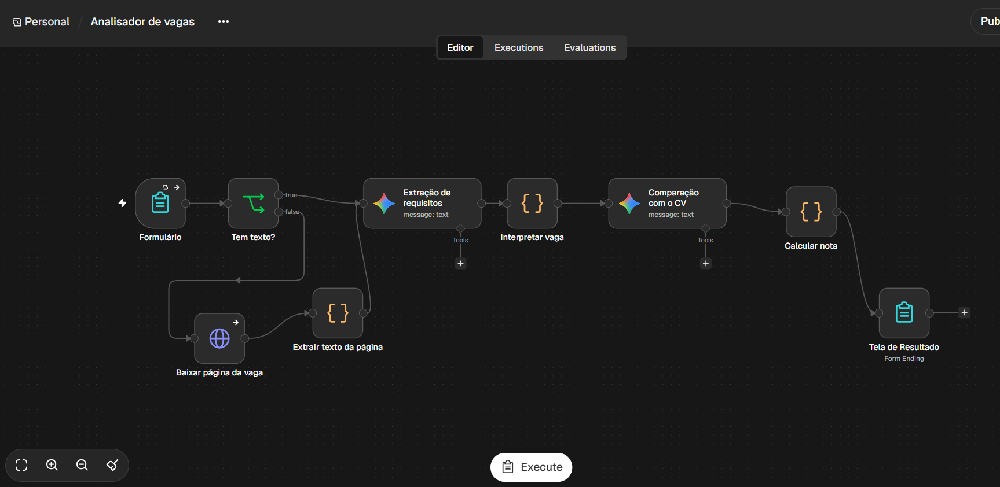
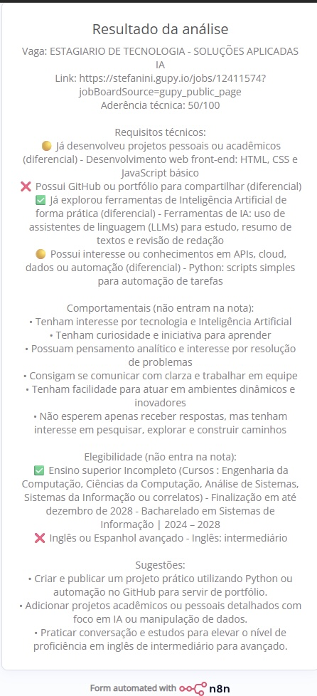

# Analisador de vagas com IA (n8n + Gemini)

Workflow no n8n que recebe uma vaga (texto ou link) e um currículo por um formulário,
compara os dois e devolve uma nota técnica com a evidência de cada requisito.

## Para que serve

Currículos costumam omitir o que a pessoa já fez, e as vagas usam palavras específicas.
A ferramenta mostra, requisito por requisito, o que o currículo comprova e o que falta,
e sugere o que acrescentar.

## Como funciona

formulário → (se só houver link, baixa a página) → Gemini extrai os requisitos em JSON →
Gemini compara cada requisito com o currículo e cita a evidência → código calcula a nota
→ página de resultado.

## Decisões de design

- **A IA classifica, o código pontua.** A nota sai de uma regra fixa (obrigatório vale 2,
  diferencial vale 1; atende = 100%, parcial = 50%), e não de um número dado pelo modelo.
- **Três categorias.** Só requisitos técnicos pontuam. Comportamentais e elegibilidade
  (matrícula, prazo de formatura, idioma) aparecem na lista, mas ficam fora da nota.
- **Sem invenção.** O prompt exige que a evidência seja um trecho do currículo. Sem trecho,
  o requisito é marcado como não atendido.
- **Falha explícita.** Campos vazios ou links ilegíveis geram uma mensagem clara, em vez de
  uma nota enganosa.
- **Privacidade.** O currículo é digitado no formulário e não fica salvo no arquivo do
  workflow. Ele é enviado ao Gemini e, no plano gratuito, esse conteúdo pode ser usado para
  melhorar produtos do Google, então use uma versão sem telefone, e-mail e endereço. O n8n
  também pode guardar o histórico de execuções localmente.

## O que testei

- **Antes e depois (uma execução de cada):** com um currículo de exemplo que dizia só "bot
  com Telegram e Gemini", o modelo marcou "noções de APIs" e "engenharia de prompts" como
  não atendidos, porque o texto nunca dizia que o bot consome APIs nem que usa prompts, e a
  nota técnica foi **33**. Depois de escrever isso de forma explícita ("consome as APIs do
  Telegram e do Gemini", "usando prompts com regras de formato"), os dois itens passaram a
  atendidos, cada um com uma evidência retirada do texto, e a nota foi **83**. Como a nota
  varia entre execuções (veja abaixo), a conclusão que sustento é a mudança nesses itens, e
  não os dois números. A ferramenta reage ao que está escrito, e não deduz o que falta.
- **Bug encontrado:** com um currículo de administração, sem nada de tecnologia, a nota
  deu **25**. O modelo deduziu "boa comunicação" a partir de "atendimento ao cliente", e
  como esse requisito obrigatório valia o dobro, ele sozinho respondia por 2 dos 8 pontos
  possíveis. Corrigi separando os requisitos em categorias. Depois da correção, o mesmo
  currículo recebeu **0**. Num segundo teste, com uma vaga real, itens de elegibilidade
  (matrícula, prazo de formatura) também pesavam na nota, então criei uma terceira
  categoria para eles.
- **Entrada por link:** colando o link de uma vaga publicada na Gupy, o workflow baixou a
  página, extraiu os requisitos e fez a análise completa, sem precisar colar o texto.
  O link de um site que bloqueia leitura automática cai na mensagem pedindo para colar o
  texto da vaga, como previsto.
- **Variação entre execuções:** rodei a mesma vaga com o mesmo currículo cinco vezes, e a
  nota técnica foi **75, 50, 50, 38 e 58** (37 pontos de diferença). O LLM extrai e
  classifica os requisitos de forma um pouco diferente a cada execução, e a lista de
  requisitos nem sempre é a mesma. A nota deve ser lida como uma faixa, e as evidências por
  requisito são a parte mais confiável.
- **Erro de formato corrigido:** em uma execução, as sugestões apareceram como
  `[object Object]`, porque o modelo devolveu objetos em vez de textos. O código passou a
  aceitar os dois formatos, e o prompt ficou mais explícito.
- **Texto depois do JSON:** em outra execução, a resposta do modelo trazia algo depois do
  fechamento do JSON, e o `JSON.parse` falhava. Passei a extrair só o primeiro objeto JSON
  completo, com uma função própria (`extrairJson`).

## Limitações

- A nota mede a aderência do texto do currículo ao texto da vaga. Ela não prevê o
  resultado de um processo seletivo.
- Testado com poucos currículos e vagas, sem comparação com avaliação humana.
- A extração e a classificação dos requisitos podem variar entre execuções.
- Sites que bloqueiam leitura automática ou carregam o conteúdo por JavaScript não
  funcionam por link. Nesse caso, cole o texto da vaga.
- Modalidades alternativas da mesma vaga (estágio e residência, por exemplo) podem ser
  tratadas como exigência.
- O modelo pode ser generoso em requisitos vagos, então confira as evidências.
- O download de links permite pedir ao workflow que acesse endereços internos (SSRF).
  Para uso público, seria preciso restringir os domínios que ele pode baixar.
- Depende de uma API de LLM e dos limites do plano gratuito.

## Como rodar

1. Instale o Node.js (LTS) e rode `npx n8n`.
2. No n8n, importe o `workflow.json` (menu do workflow → Import from File).
3. Abra os dois nós do Gemini, crie ou selecione a credencial com a sua chave (Google AI
   Studio) e escolha um modelo Flash disponível.
4. Clique em "Execute workflow", que abre o formulário. Cole a vaga ou o link e o
   currículo (sem telefone nem e-mail).
5. Os nós Code se referem uns aos outros pelo nome. Se você renomear um nó, atualize o
   nome também dentro do código.

## Próximos passos

- Extrair os requisitos uma única vez e reutilizá-los, para a nota ficar estável.
- Um painel que acumule as análises de várias vagas e mostre quais habilidades mais
  aparecem e onde estão as lacunas (em construção).
